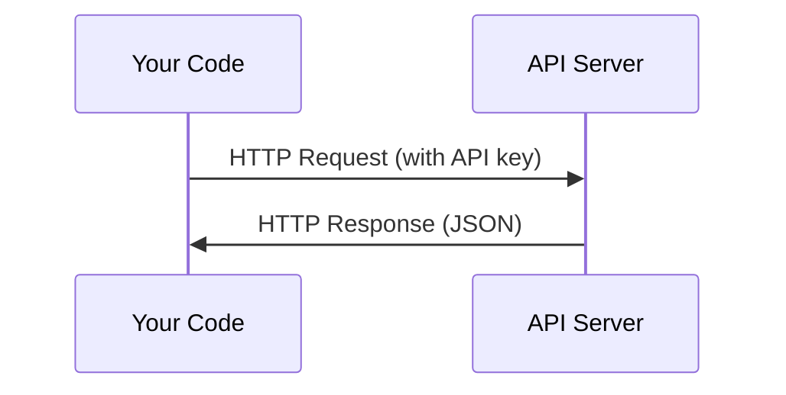

NOTE: Every AI API works the same way: send a request, get a response. The details change, the pattern doesn't.

# Every API call has:
    An endpoint (URL)
    An API key (authentication)
    A request body (what you want)
    A response body (what you get back)

The code that gets committed only names the variable; the value lives in a gitignored .env file and is injected into the process environment at runtime, then sent as an Authorization header. If the key ever appears in the source, it ships with every clone of the repo, and a leaked key bills to your account.

# STEPS ON WORKING WITH API KEYS SAFELY
1. Store API keys safely: Never put API keys in code. Use environment variables.
2. First API call(Python)
3. First API call (Typescript)
4. Raw HTTP(Hypertex Transfer Protocol)(No SDK(Software Development Kit))
# THE BIG QUESTION?
How does my code talk to a model running on someone else’s server, safely? The four objectives are the four parts of the answer.
1. Store API keys securely
What an API key is: a secret string (like sk-ant-...) tied to your account. Anyone who has it can spend your money.
The rule: never put a key in your source code.
*** You need to know three things about it:***
(a). Add .env to .gitignore immediately, before your first commit. This is the most important habit in the lesson.
(b). Load it in Python with python-dotenv:
Commit a .env.example with fake values (ANTHROPIC_API_KEY=your-key-here) so others know which variables the project needs.
2. Make an API call two ways
With the SDK (the easy way)

* Things you need to understand:
The request has three parts: the URL (endpoint), the headers (your key and API version), and the JSON body (model, max_tokens, messages).
max_tokens is required. It caps the length of the reply.
messages is a list of {role, content} objects. Roles are user and assistant. This list is how conversations work: you send the whole history every time, because the API remembers nothing between calls.
The response has a content list of blocks, and the text is at response.content[0].text. It also includes usage (input and output token counts) and stop_reason.
A system prompt goes in a separate system field, not inside messages.
3. Why compare SDK and raw HTTP?
This is a debugging skill. The SDK hides details, so when something breaks you need to see what is really being sent and received.
4. Common errors and how to handle them
Learn these status codes, because you will meet all of them:

Code	Meaning	Usual cause	                                                What to do
400	    Bad request	Malformed JSON, missing max_tokens, bad parameters	    Read the error message and fix the request
401	    Authentication error	Missing, wrong, or revoked key	            Check the key and the env variable
403	    Permission denied	Key lacks access to that resource	            Check account and permissions
404	    Not found	Wrong model name or endpoint	                        Check the current model list in the docs
429	    Rate limited	Too many requests or tokens per minute	            Wait and retry with backoff
500 / 529	Server error or overloaded	Problem on the provider’s side	    Retry after a pause
# Things to know:
API key: a secret credential that identifies and bills your account
Environment variable: a value stored outside your code and read at runtime
.env file: a local file that holds environment variables, never committed
Endpoint: the URL you send requests to
Token: a chunk of text (roughly 3/4 of a word) that models read and write, and what you are billed for
Rate limit: a cap on how many requests or tokens you can use per minute
Exponential backoff: waiting longer after each failed retry

## THINGS TO NOTE:
Command	                 Purpose
mkdir	                Creates a project directory.
cd	                    Moves into that directory.
python3 -m venv .venv	Creates an isolated Python environment.
source .venv/bin/activate	Activates the environment.
pip install anthropic	Installs the official Anthropic Python SDK.

NOTES:**Headers provide information about the request.**
1. json.dumps(payload) converts the Python dictionary into a JSON string.
2. .encode("utf-8") converts that string into bytes for the HTTP request.
Why bytes? Because HTTP request bodies are transmitted as bytes, not as native Python dictionaries.

# APIs & Keys

> Every AI API works the same way: send a request, get a response. The details change, the pattern doesn't.

**Type:** Build
**Languages:** Python, TypeScript
**Prerequisites:** Phase 0, Lesson 01
**Time:** ~30 minutes

## Learning Objectives

- Store API keys securely using environment variables and `.env` files
- Make an LLM API call using both the Anthropic Python SDK and raw HTTP
- Compare SDK-based and raw HTTP request/response formats for debugging
- Identify and handle common API errors including authentication and rate limits

## The Problem

Starting from Phase 11, you'll call LLM APIs (Anthropic, OpenAI, Google). In Phase 13-16 you'll build agents that use these APIs in loops. You need to know how API keys work, how to store them safely, and how to make your first API call.

## The Concept



Every API call has:
1. An endpoint (URL)
2. An API key (authentication)
3. A request body (what you want)
4. A response body (what you get back)

```figure
s0-secret-inject
```

## Build It

### Step 1: Store API keys safely

Never put API keys in code. Use environment variables.

```bash
export ANTHROPIC_API_KEY="sk-ant-..."
export OPENAI_API_KEY="sk-..."
```

Or use a `.env` file (add it to `.gitignore`):

```
ANTHROPIC_API_KEY=sk-ant-...
OPENAI_API_KEY=sk-...
```

### Step 2: First API call (Python)

```python
import os

import anthropic

client = anthropic.Anthropic()

MODEL = os.environ.get("LLM_MODEL", "claude-sonnet-5")

response = client.messages.create(
    model=MODEL,
    max_tokens=256,
    messages=[{"role": "user", "content": "What is a neural network in one sentence?"}]
)

print(response.content[0].text)
```

`LLM_MODEL` selects the Anthropic model id, and the default is the un-dated Sonnet alias. Other providers (OpenAI, Google, and others) follow the same pattern of a key plus a model id, but each has its own SDK, endpoint, and request/response schema.

### Step 3: First API call (TypeScript)

```typescript
import Anthropic from "@anthropic-ai/sdk";

const client = new Anthropic();

const MODEL = process.env.LLM_MODEL ?? "claude-sonnet-5";

const response = await client.messages.create({
  model: MODEL,
  max_tokens: 256,
  messages: [{ role: "user", content: "What is a neural network in one sentence?" }],
});

console.log(response.content[0].text);
```

### Step 4: Raw HTTP (no SDK)

```python
import os
import urllib.request
import json

url = "https://api.anthropic.com/v1/messages"
headers = {
    "Content-Type": "application/json",
    "x-api-key": os.environ["ANTHROPIC_API_KEY"],
    "anthropic-version": "2023-06-01",
}
body = json.dumps({
    "model": os.environ.get("LLM_MODEL", "claude-sonnet-5"),
    "max_tokens": 256,
    "messages": [{"role": "user", "content": "What is a neural network in one sentence?"}],
}).encode()

req = urllib.request.Request(url, data=body, headers=headers, method="POST")
with urllib.request.urlopen(req) as resp:
    result = json.loads(resp.read())
    print(result["content"][0]["text"])
```

This is what the SDKs do under the hood. Understanding the raw HTTP call helps when debugging.

## Use It

For this course:

| API | When you need it | Free tier |
|-----|-----------------|-----------|
| Anthropic (Claude) | Phases 11-16 (agents, tools) | $5 credit on signup |
| OpenAI | Phase 11 (comparison) | $5 credit on signup |
| Hugging Face | Phases 4-10 (models, datasets) | Free |

You don't need all of them right now. Set them up when the lesson requires it.

## Ship It

This lesson produces:
- `outputs/prompt-api-troubleshooter.md` - diagnose common API errors

## Exercises

1. Get an Anthropic API key and make your first API call
2. Try the raw HTTP version and compare the response format to the SDK version
3. Intentionally use a wrong API key and read the error message

### Hints

**Exercise 1.** Create a key in the Anthropic Console, put it in `ANTHROPIC_API_KEY` as shown in the lesson, and run `code/first_api_call.py`. The call works when the script prints the model reply and no error.

**Exercise 2.** Both functions in `code/first_api_call.py` print only the text and the token counts. Add `print(response)` in `call_with_sdk()` and `print(result)` in `call_raw_http()`, then run the script to see both full responses. Compare the field names: the raw JSON has the same `content`, `usage`, and `stop_reason` fields that the SDK turns into object attributes.

**Exercise 3.** Set `ANTHROPIC_API_KEY` to a fake value in one terminal only, then run the script again. Find the HTTP status code and the error type in the output; an authentication failure returns a 401 status.

## Key Terms

| Term | What people say | What it actually means |
|------|----------------|----------------------|
| API key | "Password for the API" | A unique string that identifies your account and authorizes requests |
| Rate limit | "They're throttling me" | Maximum requests per minute/hour to prevent abuse and ensure fair usage |
| Token | "A word" (in API context) | A billing unit: input and output tokens are counted and charged separately |
| Streaming | "Real-time responses" | Getting the response word by word instead of waiting for the full response |
